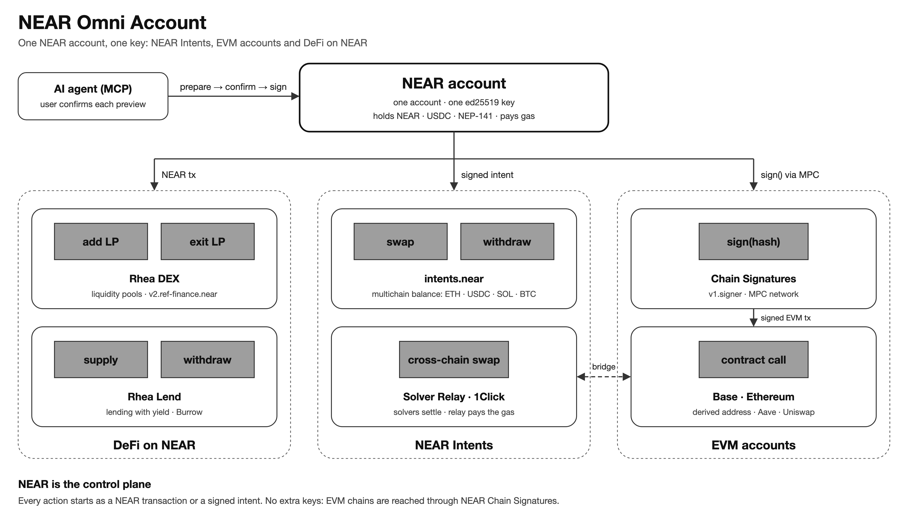
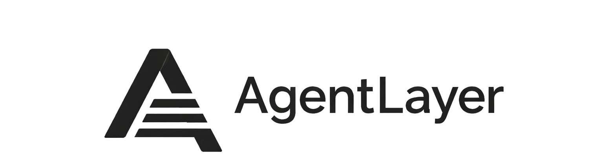

# NEAR Omni — built for the NEAR Hackathon 2026

> **Hackathon submission.** This branch (`feat/near-omni-account`) adds **NEAR Omni**, a new product built during the NEAR Hackathon on top of the existing AgentLayer repository.
> Hackathon work only: [`pre-hackathon...hackathon-submission` diff](https://github.com/lopushok9/Agent-Layer/compare/pre-hackathon...hackathon-submission) · [commit history](https://github.com/lopushok9/Agent-Layer/commits/feat/near-omni-account) · [detailed write-up ↓](#near-omni--detailed-write-up)
>
> **MCP endpoint:** `https://near-omni-mcp-production.up.railway.app/near/mcp`

AI is the new UI for blockchains, and for finance itself. But current solutions still carry a lot of friction: managing multiple keys, switching networks, and fragmented balances.

**NEAR Omni is an MCP server that gives your agents a universal balance and an environment that can call any contract on any blockchain.**

With **NEAR Chain Signatures** and **NEAR Intents**, agents control wallets across different chains using a single NEAR account.

It also addresses three fundamental blockchain problems: unsafe frontends, lack of on-chain discoverability, and complex UX/UI.

- **No frontend to trust.** Through your personal agent you interact with blockchains directly, without middlemen.
- **On-chain discoverability.** Agents get tools for querying on-chain data: DeFi lending and borrowing rates, liquidity pool yields, swap quotes, and more.
- **No UI needed.** Agents perform increasingly complex blockchain operations from a conversation.

NEAR scales these capabilities from individual blockchains to the omnichain level.

**Secure, limitless, agent-native, united by the NEAR blockchain.**

### Quick setup (Claude Code)

**1. Connect the MCP** — `https://near-omni-mcp-production.up.railway.app/near/mcp`

```bash
claude mcp add --transport http near-omni https://near-omni-mcp-production.up.railway.app/near/mcp
```

Run `/mcp`, choose `near-omni` and sign in with Google.

**2. `/balance` slash command** — one table for the NEAR wallet, NEAR Intents and Base / Ethereum:

```bash
mkdir -p ~/.claude/skills/balance && curl -fsSL https://raw.githubusercontent.com/lopushok9/Agent-Layer/feat/near-omni-account/skills/balance/SKILL.md -o ~/.claude/skills/balance/SKILL.md
```

**3. Live NEAR balance in the status line** — `Ⓝ 2.0151 NEAR` under the prompt, refreshed every 30 s (read-only, public NEAR RPC):

```bash
mkdir -p ~/.claude/near-omni && curl -fsSL https://raw.githubusercontent.com/lopushok9/Agent-Layer/feat/near-omni-account/near-omni/near_statusline.py -o ~/.claude/near-omni/near_statusline.py
```

Add to `~/.claude/settings.json`, using the account ID from `/balance`:

```json
"statusLine": {
  "type": "command",
  "command": "python3 ~/.claude/near-omni/near_statusline.py <your-near-account-id>",
  "refreshInterval": 30
}
```



---

## NEAR Omni — detailed write-up

### What it is

NEAR Omni is a remote MCP server (`/near/mcp`). When a user signs in from an AI agent (Claude Code, Codex, Cursor or any MCP client with OAuth), the server creates a **NEAR implicit account** for them with one ed25519 key. That single NEAR account is the root of everything:

| Branch | What the agent can do | How NEAR is used |
|---|---|---|
| **DeFi on NEAR** | Rhea DEX liquidity (add / exit), Rhea Lend supply / withdraw, any NEAR contract call | Plain NEAR transactions signed by the account key |
| **NEAR Intents** | Hold multichain assets (ETH, USDC, SOL, BTC, ZEC…) inside NEAR, swap them, withdraw them | Signed intents settled on `intents.near` by the Solver Relay (relay pays gas); cross-chain swaps through 1Click |
| **EVM accounts** | Use an address on Base and Ethereum: send, swap on Uniswap, supply to Aave, deposit to vaults, pay x402 APIs, register a Basename | **NEAR Chain Signatures**: the EVM address is derived from the NEAR account and every EVM transaction is signed by the `v1.signer` MPC network through a NEAR `sign()` call |

Value moves between the three places with one tool, `omni_transfer`: NEAR wallet ⇄ NEAR Intents ⇄ Base / Ethereum, optionally changing the token on the way (PoA bridge or 1Click).

There are no extra keys. The user never handles a seed phrase, an EVM private key or a bridge UI: the NEAR account controls every chain.

### NEAR stack used

| NEAR component | Used for | Code |
|---|---|---|
| Implicit accounts, NEAR RPC, `@near-js/*` | account creation, transaction building, signing, gas estimation | `src/near/account.ts`, `transaction.ts`, `operations.ts` |
| **Chain Signatures** (`v1.signer`) | derive the EVM address; MPC-sign EIP-1559, EIP-7702 and EIP-3009 (x402) payloads | `src/near/chain-signatures.ts`, `x402.ts` |
| **NEAR Intents** (`intents.near`) | multichain balance, deposits, withdrawals, signed transfer / swap intents | `src/near/intents.ts`, `solver-relay.ts` |
| **Solver Relay** | quotes and gasless settlement of intents | `src/near/solver-relay.ts` |
| **1Click API** | cross-chain swaps from the NEAR wallet, the intents balance or an EVM address | `src/near/intents.ts` |
| **PoA bridge** (`*.omft.near`) | Base / Ethereum ⇄ NEAR Intents deposits and withdrawals | `src/near/poa-bridge.ts` |
| **Rhea DEX** (`v2.ref-finance.near`) | pool search, add / remove liquidity | `src/near/rhea.ts` |
| **Rhea Lend** (`contract.main.burrow.near`) | supply / withdraw with yield | `src/near/rhea-lend.ts` |
| `wrap.near`, NEP-141 tokens | NEAR ⇄ wNEAR, token balances and transfers | `src/near/balances.ts`, `plan.ts` |

All paths are relative to `x402-payment-mcp/`.

### MCP tools (43)

- **Read (free):** `omni_balances`, `near_account_status`, `near_activity`, `near_contract_read`, `evm_address_status`, `intents_balances`, `intents_tokens`, `intents_deposit_address`, `yield_search`, `x402_search`.
- **Move value:** `omni_transfer_prepare` / `_execute` / `_status`.
- **NEAR transactions:** `near_transaction_prepare` / `_execute`, `near_plan_prepare` / `_execute` / `_status` (multi-step plans), `near_operation_status`.
- **NEAR Intents:** `intents_swap_*`, `intents_exchange_*`, `intents_trade_*`, `intents_deposit_prepare`, `intents_withdraw_*`, `intents_status`.
- **Rhea:** `rhea_lp_prepare`, `rhea_lp_exit_prepare`, `rhea_lend_supply_prepare`, `rhea_lend_withdraw_prepare`.
- **EVM via Chain Signatures:** `evm_call_prepare` / `_execute`, `evm_swap_prepare`, `evm_batch_prepare`, `evm_delegation_prepare`, `name_register_prepare`.
- **x402 API payments:** `x402_preview`, `x402_pay`, `x402_status`.

### Safety model

Every write is **prepare → user confirms → execute once → status**:

1. `*_prepare` builds the exact NEAR transaction, intent or EVM transaction, simulates it (EVM: `eth_simulateV1` with asset changes; NEAR: gas and balance checks) and returns a human-readable preview: receiver, every action, amounts, minimum received, fees. Nothing is signed.
2. The preview is stored with a fingerprint of the exact transaction and an expiry.
3. Only after the user confirms does the agent call `*_execute(operation_id)`. The server re-checks the fingerprint and nonce, re-simulates EVM calls, and refuses if anything got worse.
4. The operation is saved before signing; an unknown outcome blocks retries until `*_status` reconciles it.

RPC URLs never come from MCP input, and there is no generic "sign arbitrary bytes" tool. The NEAR key is generated on the server and stored encrypted (`NEAR_SIGNER=sealed_key`).

### Try it (hosted)

1. **Connect the MCP.** In Claude Code:
   ```bash
   claude mcp add --transport http near-omni https://near-omni-mcp-production.up.railway.app/near/mcp
   ```
   Then run `/mcp`, choose `near-omni` and sign in with Google. Any MCP client with OAuth works the same way.
2. **Ask "show my NEAR Omni balance"** → the agent calls `omni_balances` and you see one table for the NEAR wallet, NEAR Intents and Base / Ethereum, with USD values. Your NEAR account and its derived EVM address are created on first use.
3. **Ask "how do I fund my NEAR account?"** → `near_account_status` returns your account ID. Send a little NEAR to it from any wallet or exchange; the account becomes active on the first deposit.
4. **Ask "find the best USDC yield on NEAR"** → `yield_search` returns pools and lending rates with APY and TVL.
5. **Ask "preview swapping 0.2 NEAR to ETH on my Base address"** → `omni_transfer_prepare` shows the route (1Click), the quoted and minimum amount, fees and the NEAR actions. Nothing is signed.
6. **Answer "yes"** → `omni_transfer_execute` signs once with the NEAR key; `omni_transfer_status` reports `SUCCESS`, and `omni_balances` now shows ETH on Base.
7. **Ask "preview supplying 0.1 USDC to Rhea Lend"** or **"preview supplying 0.0002 ETH to Aave on Base"** → you see the exact contract call, simulated asset changes and fees before anything is signed.

### Run the tests locally

The test suite runs without credentials or network (NEAR, EVM and API clients are faked):

```bash
cd x402-payment-mcp
npm ci
npm test          # 329 tests
npm run check     # TypeScript
```

To self-host the server you need Node 24 and PostgreSQL: copy `.env.example` to `.env`, fill in the baseline server settings listed there and the `NEAR_*` block (`NEAR_RPC_URL`, `NEAR_KEY_ENCRYPTION_KEY`), then run `npm run keys`, `npm run migrate` and `npm run dev`. `NEAR.md` and `NEAR_X402.md` in `x402-payment-mcp/` describe the configuration.

### Proven on mainnet

Real operations executed through the MCP by the author's agent (NEAR explorer: nearblocks.io):

| Operation | NEAR tx | Result |
|---|---|---|
| Rhea DEX: add USDC + NEAR liquidity to pool 4512 (3-step plan) | [`9m3pojet…`](https://nearblocks.io/txns/9m3pojettTowQcYgkoLDMvphdjNDCmfhVinG7BkWUgxV) | LP shares minted |
| Rhea DEX: exit all liquidity to the wallet | [`DscDGsqa…`](https://nearblocks.io/txns/DscDGsqaSFWRhLd6uJ5SNY251JU8EHUA5zDJoaxTCvY2) | USDC + NEAR back in the wallet |
| NEAR Intents: swap ZEC → wNEAR inside the intents balance (Solver Relay, gasless) | [`HEJa7ihoA…`](https://nearblocks.io/txns/HEJa7ihoAwfE7abRGkFcXvpmjrhBY8uUeNHxRgwRnzfG) | settled by the relay |
| 1Click: NEAR from the wallet → ETH on the derived Ethereum address | [`7W3H8s3r…`](https://nearblocks.io/txns/7W3H8s3rYUf68spmC44QKephQDLJxtG9GFhQoMxnv5xg) | ETH delivered on Ethereum |
| Chain Signatures: supply ETH to Aave V3 on Ethereum | [`D4zQHVeP…`](https://nearblocks.io/txns/D4zQHVePCtYLvqzFVoCPTbSmQuSYqwrJ6oSPuUeE5R1h) | [EVM tx `0x008d99…`](https://etherscan.io/tx/0x008d993122bf06a8eeed6878ec5f79a15b2aa6507d713aa15477e9edc96ddd86) |
| Chain Signatures + EIP-7702: atomic approve + deposit into a Morpho vault on Base | [`97hWt1Mx…`](https://nearblocks.io/txns/97hWt1MxngGg3ZVbzX8spn3KfMas9wnhnBSw2jtPRYEK) | [EVM tx `0x06651d…`](https://basescan.org/tx/0x06651d3ed338544a8daff5a32ce47fcbb8345831dd3182fd6e14ab61c4e65168) |
| PoA bridge: ETH from NEAR Intents back to Base (signed intent) | [`BsSdAHw8…`](https://nearblocks.io/txns/BsSdAHw8Aep8ZLApCCHafRoEaK2hQJHZaQnMvwngfL1V) | paid out on Base in ~30 s |
| Basename registration for the derived address | [`9dhzjFcQ…`](https://nearblocks.io/txns/9dhzjFcQa81K5Tjaha4hka65C4EYLNe3G2aasi2n1ukG) | [EVM tx `0xc88db2…`](https://basescan.org/tx/0xc88db2c39cd5b1d5dc9b41fccae361fcbfc0ccf25d5b51cd9bde134e890a5d76) |
| x402: pay a data API in Base USDC, authorization signed through NEAR | [`7BEim7Kj…`](https://nearblocks.io/txns/7BEim7Kjykh2Vx1JnXqQzHaQTWzCeLrmZu9rkDTqXneZ) | API response returned |

### What existed before the hackathon and what is new

**Baseline (before the hackathon, tag `pre-hackathon`).** AgentLayer: a local agent wallet plugin (Solana / EVM) for Claude Code, Codex, Cursor, OpenClaw and Hermes, and a hosted MCP server in `x402-payment-mcp/` for a Base smart wallet with x402 payments, Google / GitHub OAuth, a Postgres operation store, verified-ABI contract decoding, ERC-7730 clear signing and `eth_simulateV1` previews. These are other-chain components and are not part of the submission.

**Built during the hackathon (10–14 Nov 2026, [diff](https://github.com/lopushok9/Agent-Layer/compare/pre-hackathon...hackathon-submission)).** Everything NEAR:

- the separate `/near/mcp` resource and its 43 tools (`x402-payment-mcp/src/near/`, 23 modules);
- NEAR accounts and signing, NEAR plans, NEAR Intents, Solver Relay, 1Click, PoA bridge, Rhea DEX, Rhea Lend, Chain Signatures EVM accounts with EIP-7702 batches, `omni_transfer`, `omni_balances`, x402 payments and Basename registration through Chain Signatures;
- migrations `014`–`018`, tests `tests/near-*.test.ts`, skills `skills/balance` and `skills/near-x402`, `NEAR.md`, `NEAR_X402.md`, `NEAR_OMNI_ACCOUNT_SPEC.md`.

The NEAR product reuses baseline infrastructure: OAuth login, the Postgres connection, the deployment's EVM RPCs, contract ABI decoding and clear signing, x402 service discovery and the name-registration module. It runs as an independent resource and does not change the Base smart-wallet `/mcp`.

**Libraries and services.** `@near-js/crypto`, `@near-js/transactions`, `@near-js/types`, `@near-js/utils`, `viem`, `@modelcontextprotocol/server`, `express`, `pg`, `zod`, `@x402/*`, `@ethereum-sourcify/clear-signing`; NEAR RPC (FastNEAR), NEAR Intents 1Click, Solver Relay and PoA bridge APIs, the Rhea API, DeFiLlama yields. Code was written with AI coding assistants (Claude Code, Codex) under the author's review.

This is the author's only NEAR Hackathon submission. License: [PolyForm Small Business 1.0.0](LICENSE).

---

# AgentLayer (pre-hackathon baseline)



[](https://www.npmjs.com/package/@agentlayer.tech/wallet)
[](https://www.npmjs.com/package/@agentlayer.tech/wallet)
[](https://nodejs.org/)
[](https://docs.agent-layer.tech/)

Try AgentLayer — an agent-native, local crypto wallet with built-in tools from leading protocols: pay with x402, swap, earn yield, and issue fiat cards with stables.

## Install

```bash
npx --yes @agentlayer.tech/wallet@latest install --yes
```
It works with:

- Codex
- Cursor
- Claude Code
- OpenClaw
- Hermes

You need:

- Node.js 24
- npm
- Python 3

Restart your agents after installation.

### x402 payments only (no install, MCP)

If you only need x402 payments on base, connect this remote MCP instead:

```text
https://x402.agent-layer.tech/mcp
```

This is just an MCP server. It gives access to x402 payments (search paid
services, preview, and pay in USDC on Base) plus basic USDC receive and send
on Arc — it is not the full AgentLayer wallet: no Solana, swaps, or DeFi. Add it as a custom
connector in any MCP host that supports remote servers with OAuth (for
example Claude) and sign in with Google or GitHub.

**Meta Muse:** open https://x402.agent-layer.tech/muse, sign in, and create a
personal access token. The page gives you a ready prompt for Muse; enter the
token only in Muse's secure credential prompt, not in the chat. See
[Hosted x402 payment MCP](#hosted-x402-payment-mcp) for details.

### Choose frameworks explicitly

```bash
npx --yes @agentlayer.tech/wallet@latest install --yes --hosts codex,claude-code
```

Supported host names are:

```text
codex
cursor
claude-code
openclaw
hermes
```

To see what AgentLayer detects:

```bash
npx --yes @agentlayer.tech/wallet@latest detect --json
```

## Update

If the `wallet` command is available:

```bash
wallet update --yes
```

If the CLI is missing or outdated:

```bash
npx --yes @agentlayer.tech/wallet@latest update --yes
```

An update refreshes the shared runtime and the frameworks already connected to
AgentLayer. It does not add a newly installed framework without your choice.

To update only selected frameworks:

```bash
npx --yes @agentlayer.tech/wallet@latest update --yes --hosts codex,claude-code
```

Preview an update without applying it:

```bash
wallet update --yes --dry-run
```

## Check the installation

```bash
wallet status
wallet doctor
```

## Universal local MCP

Any MCP client that supports the standard local `stdio` transport can use the
same wallet runtime without installing a Codex, Cursor, Claude Code, OpenClaw,
or Hermes plugin. Install the runtime, then print a ready-to-paste MCP config:

```bash
npx --yes @agentlayer.tech/wallet@latest install --yes --runtime-only
npx --yes @agentlayer.tech/wallet@latest mcp config
```

The generated config starts a local process at the stable
`agent-wallet-runtime/current` path. It exposes the same wallet tools as the
Codex, Cursor, and Claude Code bridges. Transaction policy, preview/prepare/execute,
and approval checks remain enforced by the shared Python wallet runtime.

For clients that ask for an executable path instead of JSON, use:

```bash
npx --yes @agentlayer.tech/wallet@latest mcp path
```

If the global CLI is not installed:

```bash
npx --yes @agentlayer.tech/wallet@latest status
npx --yes @agentlayer.tech/wallet@latest doctor
```

After an install or update, restart the connected agent applications when
`wallet status` shows `restart_required: true`.

## Hosted x402 payment MCP

Connect URL: `https://x402.agent-layer.tech/mcp`

Cloud-agent and mobile-host users can be served by the separate
[`x402-payment-mcp/`](x402-payment-mcp/README.md). It is remote MCP with
first-party OAuth (Google/GitHub login), one CDP-managed Base wallet per user, and Base USDC x402 payments. It does not replace or
share custody assumptions with the local wallet runtime.

## Common commands

```bash
wallet detect --json
wallet status
wallet doctor
wallet update --yes
wallet rollback
```

## Optional connectors

Connectors add optional third-party crypto and DeFi read tools without moving
existing integrations such as Aave, Kamino, or Morpho out of the wallet core.

```bash
wallet connectors inspect ./connector.json
wallet connectors install ./connector.json --enable --yes
wallet connectors list
wallet connectors disable com.example.protocol
wallet connectors doctor
```

Enabled read-only connectors appear in OpenClaw and Codex after the host is
restarted. Write-capable connectors remain unavailable until their verified,
AgentLayer-hosted execution path is fully enabled. See
[`connectors/README.md`](connectors/README.md) for the trust model and protocol.

## What AgentLayer provides

AgentLayer connects supported agents to one local wallet runtime. The agent can:

- view balances and portfolio positions
- send and receive supported assets
- swap tokens
- use supported DeFi services
- access paid APIs through x402
- work with Solana, Ethereum, and Base

Read operations are available directly. Operations that move funds remain
protected by wallet policy and approval checks.


## Claude Code marketplace

Claude Code users can also install the plugin from its marketplace:

```text
/plugin marketplace add lopushok9/Agent-Layer
/plugin install agent-wallet@agentlayer
```

Restart Claude Code after installation.

## ChatGPT desktop and Codex marketplace

As an alternative to the npm installer, add the public AgentLayer Git
marketplace and install the local wallet plugin:

```bash
codex plugin marketplace add lopushok9/Agent-Layer
codex plugin add agent-wallet@agentlayer
```

Restart ChatGPT desktop or Codex, then select Agent Wallet from the AgentLayer
source in the Plugins Directory. On first MCP start, the plugin installs the
shared wallet runtime through `@agentlayer.tech/wallet` if it is missing. This
requires Node.js 24, npm, and Python 3. The wallet and signing policy stay on
your machine. The npm installer above remains the primary installation path;
it can also update and repair the runtime installed through this marketplace.

The marketplace plugin uses the same local wallet as the npm installation. If
you already installed `agent-wallet@local`, use one of the two plugin entries in
a session to avoid duplicate wallet tools.

## OpenClaw plugin

OpenClaw users can also install the native plugin from ClawHub:

```bash
openclaw plugins install clawhub:@agentlayertech/agent-wallet-plugin
```

The universal npm installer is still required to prepare the local wallet
runtime.

## Security

The agent receives wallet capabilities, not wallet keys.

- Keys and signing stay on the user's machine.
- Wallet secrets are encrypted locally.
- Updates preserve existing wallets and identities.
- Transactions remain subject to wallet policy and approvals.

On macOS, AgentLayer uses the login Keychain by default. macOS may ask for
Keychain access during an install or update. Approve it only when you initiated
the AgentLayer command.

Keep a secure offline copy of your recovery key.

## License

This repository is available under the PolyForm Small Business License 1.0.0.
Individuals, researchers, students, security reviewers, hobbyists, and eligible
small businesses may use and modify it under the terms of that license.
